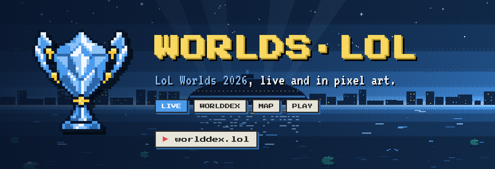
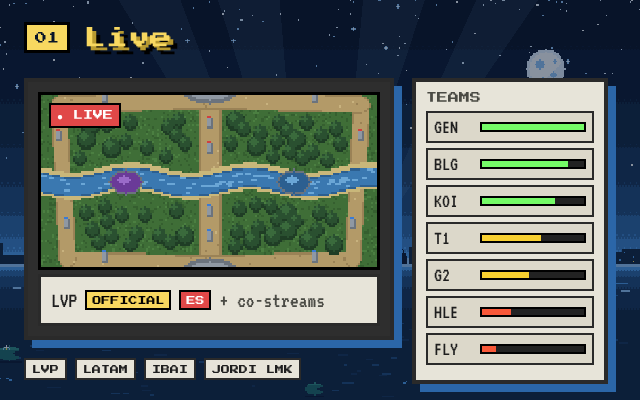
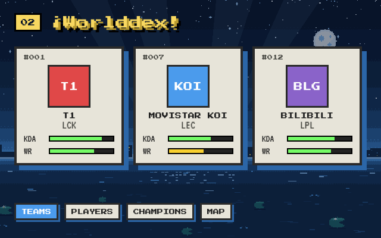
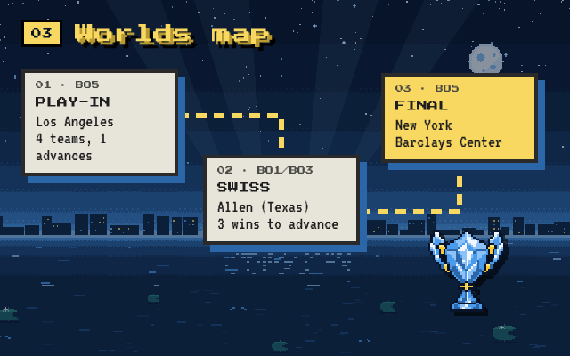
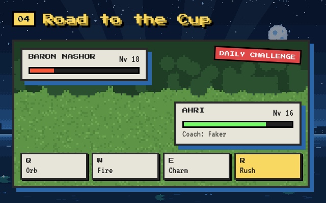

<p align="center">
  <a href="https://worlddex.lol/en"></a>
</p>

<p align="center">
  <a href="https://worlddex.lol/en"><b>▶ worlddex.lol/en</b></a>
  &nbsp;·&nbsp;
  <a href="https://worlddex.lol/en/play"><b>Play</b></a>
  &nbsp;·&nbsp;
  <a href="README.md">🇪🇸 Español</a>
</p>

<p align="center">
  <a href="https://worlddex.lol/en"></a>
  
  
  
  
  
  
</p>

<br>

**WORLDS·LOL** is a fan site for following the 2026 League of Legends World Championship, styled like a pocket RPG: a pixel night sky, cream cards, HP bars and 8-bit type. Live broadcasts with co-streams, standings updated every minute, a Worlddex of teams, players and champions, the Worlds route map from Los Angeles to New York, and an original game to play between matches. Made in Spain, in Spanish first and fully in English.

<br>

<table>
  <tr>
    <td width="50%" valign="top">
      
      <h3>📺 Live</h3>
      <p>A big player with Riot's official English broadcast, the official Spanish ones (Spain and Latin America) and Spanish co-streamers. Fullscreen, one-click stream switching, and a mini player that follows you across tabs.</p>
      <p>On the right, an interactive teams table: filter by region, recent form as HP bars, and each team's card with its roster. When nothing is live, a notice tells you who plays next and when, in your time zone.</p>
    </td>
    <td width="50%" valign="top">
      
      <h3>📖 Worlddex</h3>
      <p>The tournament encyclopedia, Pokédex style. All 19 qualified teams ordered by Riot's Global Power Rankings, their players with KDA and champions, and the most played champions of Worlds, all from the official per-game stats.</p>
      <p>Includes the <a href="https://worlddex.lol/en/stats/worlds-2025">Worlds 2025</a> archive for comparison.</p>
    </td>
  </tr>
  <tr>
    <td width="50%" valign="top">
      
      <h3>🗺️ Worlds map</h3>
      <p>The tournament route as an adventure map: Play-In in Los Angeles, Swiss stage in Allen (Texas) and knockouts all the way to the final at Barclays Center in New York. The bracket fills itself in from the results.</p>
    </td>
    <td width="50%" valign="top">
      
      <h3>🏆 Road to the Cup</h3>
      <p>An original roguelike with Worlds pros as coaches. Draft players, fight with each champion's real Q W E R, buy items, take on dragons and Baron, and reach the final with a single life.</p>
      <p>Every day brings a <b>daily challenge</b> that is the same for everyone, like Wordle. When you finish, share your card or dare a friend to play your exact run. <a href="https://worlddex.lol/en/play">Play here</a>.</p>
    </td>
  </tr>
</table>

<br>

## 🛠️ How it's built

| | |
|---|---|
| **Web** | Next.js 16 (App Router) and React 19 in TypeScript, no UI libraries: all the pixel art is hand-written CSS (`app/globals.css`) and script-generated SVG. |
| **Data** | The [lolesports](https://lolesports.com) API for schedule, results, standings and live broadcasts; `feed.lolesports.com/livestats` for per-game stats; [Data Dragon](https://developer.riotgames.com/docs/lol#data-dragon) for champions, abilities and items. |
| **Art** | Night sky, game map and arenas drawn with Python (`scripts/gen-scene.py`, `scripts/gen-rift.py`). The cup logo is converted to a 40×40 pixel grid (`scripts/logo-from-png.py`). |
| **Fonts** | [Press Start 2P](https://fonts.google.com/specimen/Press+Start+2P) and [VT323](https://fonts.google.com/specimen/VT323), OFL licensed. |
| **Hosting** | Vercel, with static pages regenerated every minute. |

## 🚀 Run it locally

```bash
npm install
npm run dev        # http://localhost:3000
npm run typecheck
```

If the lolesports API is unreachable (for example offline), the site shows demo data and says so.

## ⚙️ Configuration

- `config/streams.ts`: player channels. Official channels the API reports as live are added automatically.
- `config/tournament.ts`: the tournament being followed, qualified teams and map venues. Add an entry to reuse the site for the LEC, MSI or next year's Worlds.
- `config/site.ts`: author credit.
- `LOLESPORTS_API_KEY` (optional): lolesports API key, in case the public one changes.

The data comes from the API behind lolesports.com, which is neither public nor documented and may change without notice.

<details>
<summary><b>📁 Project structure</b></summary>

```
app/[lang]/          Spanish and English pages (live, stats, play)
app/api/             worlds, stats, map and image endpoints
components/          player, teams table, Worlddex, map, next-match notice
components/game/     game UI (map, battle, shop, sharing)
lib/                 lolesports and Data Dragon clients, bracket, i18n
lib/game/            game engine, data, spells and daily challenge
config/              streams, tournaments and author credit
scripts/             pixel art generators and this README's images
```

The images in this README come from `.github/readme/art.html`; to regenerate them: `npm i --no-save playwright && node scripts/readme-art.mjs`.

</details>

## ⚖️ Legal

worlddex.lol was created under Riot Games' ["Legal Jibber Jabber"](https://www.riotgames.com/en/legal) policy using assets owned by Riot Games. Riot Games does not endorse or sponsor this project. Non-profit fan site with no ads. Data and broadcasts from lolesports.com. League of Legends and all team and player names belong to their respective owners.

<br>

<p align="center">
  
  <br>
  <sub>Developed by <a href="https://www.linkedin.com/in/javier-saeta/"><b>SAETA</b></a></sub>
</p>
