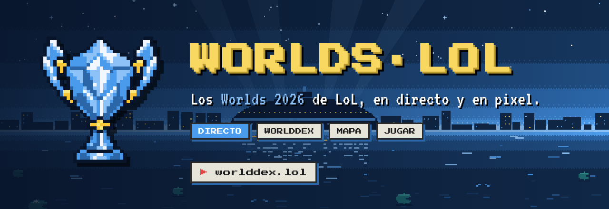
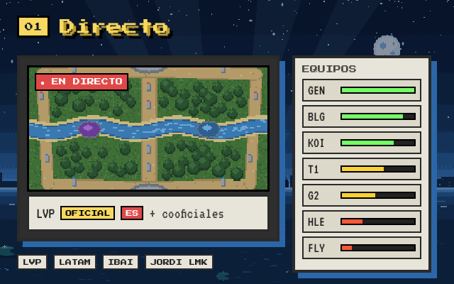
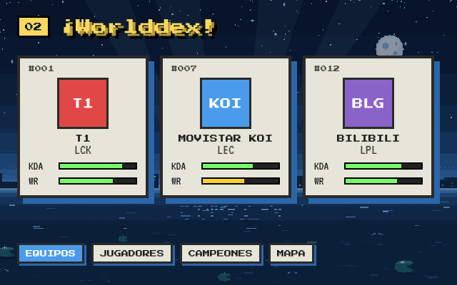
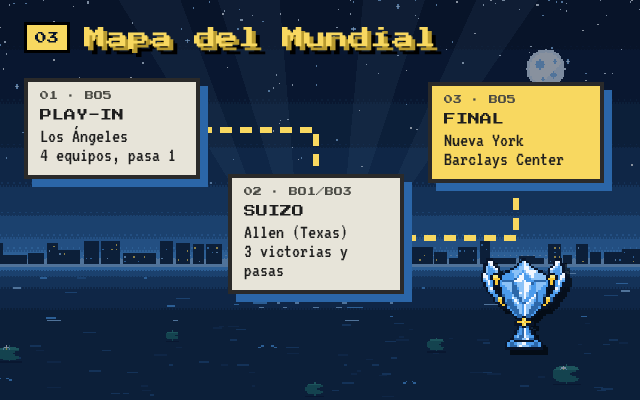
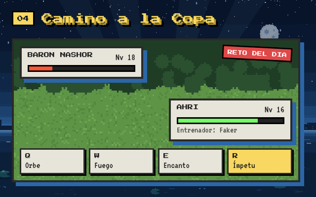

<p align="center">
  <a href="https://worlddex.lol"></a>
</p>

<p align="center">
  <a href="https://worlddex.lol"><b>▶ worlddex.lol</b></a>
  &nbsp;·&nbsp;
  <a href="https://worlddex.lol/jugar"><b>Jugar</b></a>
  &nbsp;·&nbsp;
  <a href="README.en.md">🇬🇧 English</a>
</p>

<p align="center">
  <a href="https://worlddex.lol"></a>
  
  
  
  
  
  
</p>

<br>

**WORLDS·LOL** es una web de fans para seguir el Campeonato del Mundo de League of Legends 2026 en español, con la estética de un RPG de bolsillo: cielo pixelado, cartas color crema, barras de vida y tipografía de 8 bits. Directo con los cooficiales, la clasificación al minuto, una Worlddex con equipos, jugadores y campeones, el mapa del Mundial de Los Ángeles a Nueva York y un juego propio para jugar entre partido y partido.

<br>

<table>
  <tr>
    <td width="50%" valign="top">
      
      <h3>📺 Directo</h3>
      <p>Reproductor grande con la emisión oficial de España (LVP), la de Latinoamérica, la de Riot en inglés y los cooficiales en español: Ibai, Jordi LMK, Toad, Cabramaravilla y más. Pantalla completa, cambio de emisión con un clic y un mini reproductor que te sigue al cambiar de pestaña.</p>
      <p>A la derecha, la tabla de equipos interactiva: filtro por región, forma reciente en barras de vida y la ficha de cada equipo con su plantilla. Si no hay nada en directo, un aviso te dice cuándo y quién juega el próximo partido, a tu hora.</p>
    </td>
    <td width="50%" valign="top">
      
      <h3>📖 Worlddex</h3>
      <p>La enciclopedia del torneo al estilo Pokédex. Los 19 equipos clasificados ordenados por el ranking global de Riot, sus jugadores con KDA y campeones, y los campeones más jugados del Mundial, todo sacado de las estadísticas oficiales de cada partida.</p>
      <p>Incluye el archivo de los <a href="https://worlddex.lol/estadisticas/worlds-2025">Worlds 2025</a> para comparar.</p>
    </td>
  </tr>
  <tr>
    <td width="50%" valign="top">
      
      <h3>🗺️ Mapa del Mundial</h3>
      <p>El recorrido del torneo como un mapa de aventura: Play-In en Los Ángeles, fase suiza en Allen (Texas) y eliminatorias hasta la final en el Barclays Center de Nueva York. El cuadro se rellena solo con los resultados.</p>
    </td>
    <td width="50%" valign="top">
      
      <h3>🏆 Camino a la Copa</h3>
      <p>Un roguelike propio con los pros del Mundial como entrenadores. Elige jugadores, combate con los Q W E R reales de cada campeón, compra objetos, pelea contra dragones y el Barón, y llega a la final con una sola vida.</p>
      <p>Cada día hay un <b>reto del día</b> igual para todos, como Wordle, y al acabar compartes tu tarjeta o retas a un amigo a jugar tu misma partida. <a href="https://worlddex.lol/jugar">Juega aquí</a>.</p>
    </td>
  </tr>
</table>

<br>

## 🌍 En español y en inglés

Toda la web tiene versión inglesa en [worlddex.lol/en](https://worlddex.lol/en), con rutas propias (`/en/stats`, `/en/play`), los canales en inglés primero y el juego traducido. El selector ES · EN recuerda tu elección.

## 🛠️ Cómo está hecho

| | |
|---|---|
| **Web** | Next.js 16 (App Router) y React 19 en TypeScript, sin librerías de UI: todo el pixel art está en CSS propio (`app/globals.css`) y SVG generados por script. |
| **Datos** | API de [lolesports](https://lolesports.com) para calendario, resultados, clasificación y emisiones en directo; `feed.lolesports.com/livestats` para las estadísticas de cada partida; [Data Dragon](https://developer.riotgames.com/docs/lol#data-dragon) para campeones, habilidades y objetos. |
| **Arte** | Fondo nocturno, mapa y arenas del juego dibujados con Python (`scripts/gen-scene.py`, `scripts/gen-rift.py`). Logo de la copa convertido a una rejilla de 40×40 píxeles (`scripts/logo-from-png.py`). |
| **Tipografías** | [Press Start 2P](https://fonts.google.com/specimen/Press+Start+2P) y [VT323](https://fonts.google.com/specimen/VT323), con licencia OFL. |
| **Despliegue** | Vercel, con páginas estáticas que se regeneran cada minuto. |

## 🚀 En local

```bash
npm install
npm run dev        # http://localhost:3000
npm run typecheck
```

Si la API de lolesports no responde (por ejemplo sin red), la web muestra datos de demostración y lo avisa.

## ⚙️ Configuración

- `config/streams.ts`: canales del reproductor. Los oficiales que la API marque en directo se añaden solos.
- `config/tournament.ts`: torneo que se sigue, equipos clasificados y sedes del mapa. Añadiendo una entrada se reutiliza la web para la LEC, el MSI o el próximo Mundial.
- `config/site.ts`: firma del autor.
- `LOLESPORTS_API_KEY` (opcional): clave de la API de lolesports si la pública cambia.

Los datos vienen de la API que usa lolesports.com, que no es pública ni está documentada y puede cambiar sin aviso.

<details>
<summary><b>📁 Estructura del proyecto</b></summary>

```
app/[lang]/          páginas en español y en inglés (directo, estadísticas, jugar)
app/api/             worlds, stats, mapa e imágenes
components/          reproductor, tabla de equipos, Worlddex, mapa, aviso de próximo partido
components/game/     interfaz del juego (mapa, combate, tienda, compartir)
lib/                 clientes de lolesports y Data Dragon, cuadro del torneo, i18n
lib/game/            motor del juego, datos, hechizos y reto del día
config/              emisiones, torneos y firma
scripts/             generadores del arte pixel y de esta portada
```

Las imágenes de esta portada salen de `.github/readme/art.html`; para regenerarlas: `npm i --no-save playwright && node scripts/readme-art.mjs`.

</details>

## ⚖️ Aviso legal

worlddex.lol se ha creado bajo la política [«Legal Jibber Jabber»](https://www.riotgames.com/en/legal) de Riot Games usando recursos propiedad de Riot Games. Riot Games no respalda ni patrocina este proyecto. Web de fans sin ánimo de lucro y sin publicidad. Datos y emisiones de lolesports.com. League of Legends y los nombres de equipos y jugadores pertenecen a sus respectivos dueños.

<br>

<p align="center">
  
  <br>
  <sub>Desarrollado por <a href="https://www.linkedin.com/in/javier-saeta/"><b>SAETA</b></a></sub>
</p>
